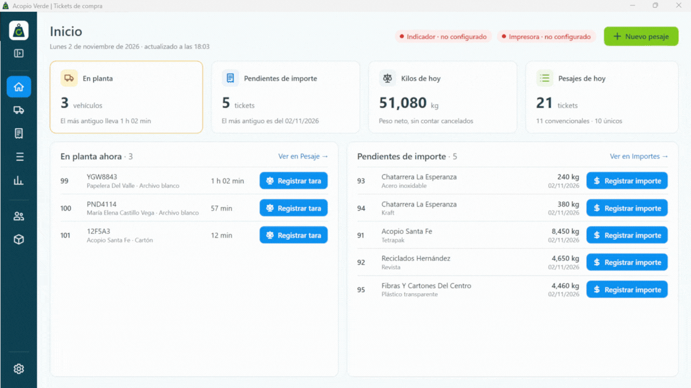
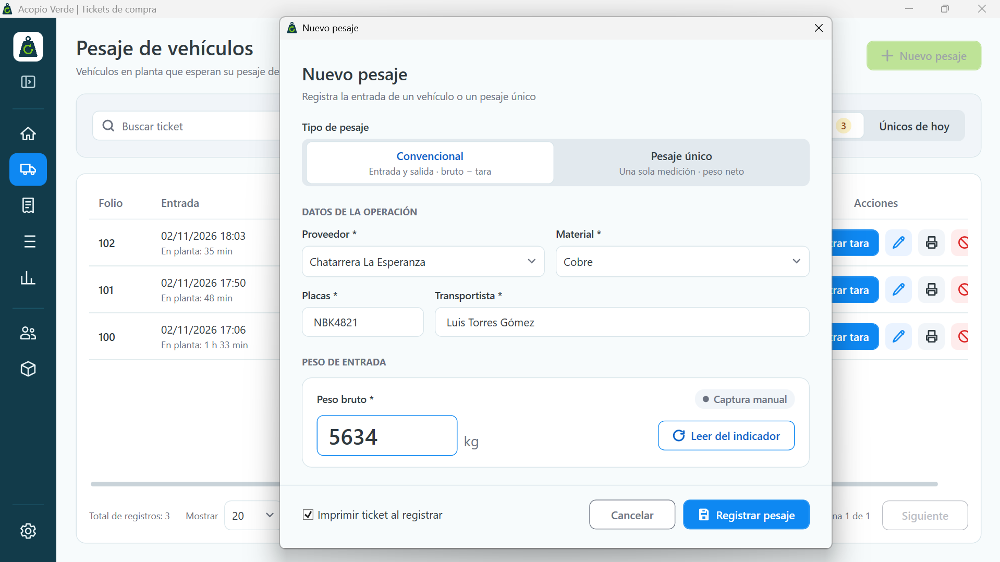
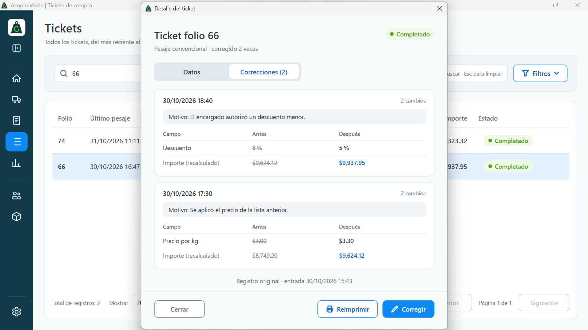
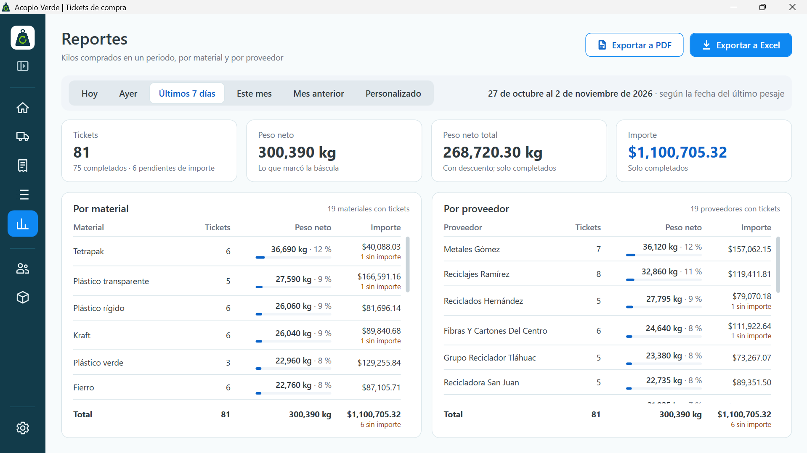
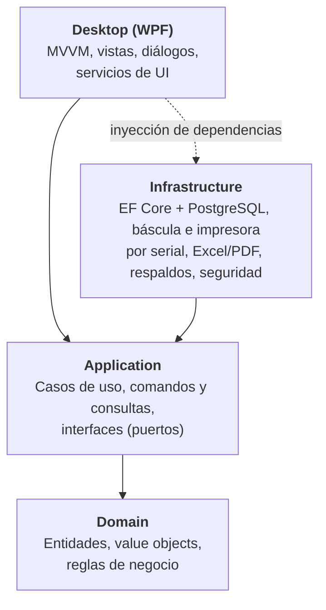

# Acopio Verde

Sistema de escritorio multiusuario para **centros de acopio de reciclaje**: registra el pesaje de vehículos directamente desde la báscula, calcula importes, imprime tickets de compra y genera reportes. Se entregará al cliente bajo licencia de uso y funciona en red local, sin necesidad de internet.

> **Código privado.** Este repositorio es una vitrina del proyecto. El código fuente no es público por tratarse de un producto comercial, pero está disponible para revisión durante una entrevista técnica.

     

---

## El problema

En un centro de acopio, cada vehículo que llega con material se pesa al entrar y al salir. El centro capturaba cada ticket de compra **dos veces, en dos sistemas distintos**:

1. Una aplicación de escritorio, conectada al indicador de peso y a la impresora, generaba el ticket físico: placas, chofer, proveedor, material, peso bruto y, cuando el vehículo regresaba descargado, la tara.
2. Otra aplicación guardaba el ticket en una base de datos. El empleado volvía a capturar los mismos datos a partir de la copia en papel y agregaba el descuento y el precio por kilogramo.

La doble captura era lenta y propensa a errores, la información quedaba repartida y no había forma de auditar quién cambió un importe ni cuándo. El objetivo fue **unir ambos procesos en una sola aplicación con una base de datos central**, reduciendo la captura manual.

## La solución

- **Pesaje automático**: lee el peso directamente del indicador de la báscula (Dini Argeo 3590EXP) por puerto serial y espera a que la lectura sea estable.
- **Dos tipos de pesaje**: convencional (entrada y salida del vehículo, peso bruto y tara) y pesaje único.
- **Cálculo de importes**: peso neto, descuentos y precio por kilogramo, con el desglose visible para el operador.
- **Impresión de tickets** en impresora de matriz de puntos (Epson TM-U295) por puerto serial, con reimpresión.
- **Correcciones auditables**: cada corrección a un ticket guarda qué campo cambió, el valor anterior y el nuevo. Corregir y cancelar requieren clave de acceso.
- **Catálogos** de proveedores y materiales, con activación y desactivación.
- **Reportes** de compras exportables a Excel y PDF.
- **Respaldos** manuales y automáticos diarios de la base de datos, y restauración con un respaldo de seguridad previo.
- **Multiusuario**: varias PCs trabajan sobre la misma base de datos en la red local.
- **Actualización automática**: las pantallas de pesaje, importes y tickets se refrescan solas cada 30 segundos para mostrar lo que registran las demás PCs.

## Mi rol

Responsable del proyecto de principio a fin: levanté los requerimientos con el cliente y elaboré el documento de análisis, diseñé la base de datos, definí la arquitectura (Clean Architecture), los requerimientos funcionales y las reglas de negocio, y dirigí la implementación con **Claude Code** como asistente de desarrollo: ajustamos el modelo de datos a los procesos reales del centro de acopio, revisé el código, validé las pruebas, tomé las decisiones de diseño y preparé el instalador y la guía de despliegue. La versión 1.0.0 está en validación con el cliente antes de su entrega.

---

## Análisis y diseño

Antes de escribir código elaboré un documento de análisis del proceso, que se fue actualizando durante el desarrollo:

- **Situación actual**: cómo se capturaban los tickets, quién lo hacía, qué datos se necesitaban y qué pasos eran manuales.
- **61 requerimientos funcionales**: 47 originales y 14 que surgieron durante el desarrollo (concurrencia, respaldos, clave de acceso, configuración de la conexión).
- **15 requerimientos no funcionales**: usabilidad, integridad de datos, trabajo simultáneo en hasta 5 PCs, operación sin internet y protección de la clave de acceso.
- **6 actores**: empleado, chofer, encargado, indicador de peso, impresora y servidor de base de datos.
- **28 casos de uso** con su descripción (flujo principal, alternos y reglas), por ejemplo registrar pesaje de entrada y salida, corregir y cancelar tickets, o restaurar un respaldo.
- **Matriz de trazabilidad**: cada requerimiento funcional está cubierto por al menos un caso de uso.

El análisis también definió los dos tipos de ticket:

| Pesaje convencional | Un solo pesaje |
| --- | --- |
| Material transportado en vehículo | Material colocado directamente sobre la báscula |
| Peso de entrada; el ticket queda pendiente hasta la tara | Una única medición; no queda pendiente |
| Peso neto = peso bruto − tara | Peso neto = peso obtenido |

El resumen del análisis, con actores, casos de uso, un caso de uso completo y un extracto de la matriz de trazabilidad, está en [docs/analisis.md](docs/analisis.md).

## Arquitectura

Clean Architecture en 4 capas, con las reglas de negocio aisladas en el dominio y la infraestructura (base de datos, puertos seriales, impresión, reportes) detrás de interfaces.

| Capa | Responsabilidad | Ejemplos |
| --- | --- | --- |
| **Domain** | Reglas de negocio puras, sin dependencias externas | `PurchaseTicket`, `Supplier`, `Material`, `TicketCorrection`, `AmountBreakdown` |
| **Application** | Casos de uso organizados por funcionalidad | `CreateConventionalPurchaseTicket`, `RegisterDepartureWeight`, `CorrectPurchaseTicket`, `GetPurchaseReport` |
| **Infrastructure** | Implementación de los puertos | Repositorios EF Core, lector de peso serial, impresora serial, exportadores ClosedXML/QuestPDF, `pg_dump` |
| **Desktop** | Interfaz WPF con MVVM y componentes reutilizables | ViewModels, diálogos, paginación, notificaciones |

## Decisiones técnicas destacadas

- **Dominio rico**: las entidades protegen sus invariantes (validación de pesos, descuentos y precios; transiciones de estado del ticket). La aplicación no puede dejar un ticket en un estado inválido.
- **Concurrencia optimista**: tokens de concurrencia en EF Core para que dos PCs no sobrescriban el mismo ticket sin darse cuenta; el conflicto se informa al usuario.
- **Historial de correcciones**: las correcciones generan registros inmutables de cambio por campo, consultables desde el detalle del ticket.
- **Seguridad**: la clave de acceso se almacena como hash PBKDF2-SHA256 con sal aleatoria, nunca en texto plano.
- **Hardware desacoplado**: báscula e impresora se usan a través de interfaces (`IWeightReader`, `ITicketPrinter`), lo que permite probar la lógica sin dispositivos físicos.
- **Calidad de código**: analizadores StyleCop, logging estructurado con Serilog y migraciones versionadas de EF Core.

## Pruebas

**391 métodos de prueba con xUnit** (340 `[Fact]` y 51 `[Theory]`), distribuidos en tres proyectos.

Cada cambio se hacía primero en Domain o Application y después se escribían sus pruebas con Claude Code. Yo las ejecutaba y revisaba; cuando alguna fallaba, analizábamos si el error estaba en la prueba o en la regla de negocio antes de seguir.

| Proyecto | Qué prueba |
| --- | --- |
| `Domain.Tests` | Reglas de negocio de entidades y value objects |
| `Application.Tests` | Casos de uso con repositorios y dispositivos simulados |
| `Infrastructure.Tests` | Persistencia y componentes de infraestructura |

## Despliegue

- **Servidor**: PostgreSQL 17 en un contenedor Docker (Docker Compose) en una PC de la red local.
- **Clientes**: instalador para Windows generado con Inno Setup; cada PC se conecta al servidor por la red.
- **Operación sin internet**: solo se necesita durante la instalación.
- **Configuración por PC**: puertos de báscula e impresora, encabezado del ticket y respaldo automático.
- **Datos locales centralizados**: la conexión (cifrada con DPAPI), la configuración y los logs de cada PC viven en `C:\ProgramData\AcopioVerde`.

## Tecnologías

| Área | Tecnologías |
| --- | --- |
| Lenguaje y plataforma | C#, .NET 10 |
| Interfaz | WPF, MVVM |
| Datos | PostgreSQL 17, Entity Framework Core 10 (Npgsql), migraciones |
| Hardware | System.IO.Ports (indicador de peso e impresora de tickets) |
| Reportes | ClosedXML (Excel), QuestPDF (PDF) |
| Pruebas | xUnit, Coverlet |
| Infraestructura | Docker Compose, Inno Setup, `pg_dump` / `pg_restore` |
| Calidad | StyleCop Analyzers, Serilog |

---

## Autor

**Juan Jesús Ortega Zambrano** · Desarrollador Backend .NET

- LinkedIn: https://www.linkedin.com/in/juan-ortega-dev/
- Correo: juanortegazbrn@gmail.com
- GitHub: [@JNua0](https://github.com/JNua0)
