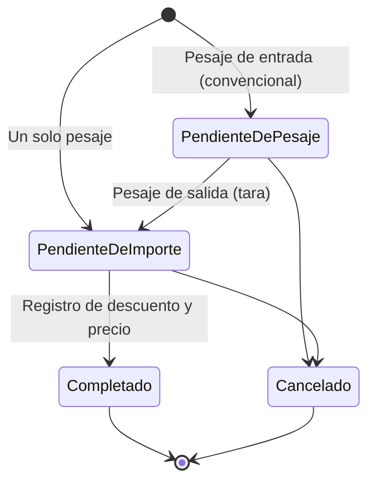

# Análisis del proceso — Acopio Verde

[← Volver al README](../README.md)

Resumen del documento de análisis que elaboré antes de comenzar el desarrollo y que fui actualizando hasta la versión 1.0.0. El documento completo forma parte de la documentación que se entregará al cliente; aquí se incluye una versión reducida, sin datos del cliente, para mostrar el proceso de análisis.

## Contenido

1. [Situación actual](#1-situación-actual)
2. [Objetivo](#2-objetivo)
3. [Tipos de ticket y estados](#3-tipos-de-ticket-y-estados)
4. [Actores](#4-actores)
5. [Alcance en números](#5-alcance-en-números)
6. [Requerimientos no funcionales](#6-requerimientos-no-funcionales)
7. [Casos de uso](#7-casos-de-uso)
8. [Ejemplo: CU-06 Corregir ticket](#8-ejemplo-cu-06-corregir-ticket)
9. [Extracto de la matriz de trazabilidad](#9-extracto-de-la-matriz-de-trazabilidad)

---

## 1. Situación actual

El centro de acopio capturaba cada ticket de compra **dos veces, en dos sistemas distintos**.

**Sistema 1: ticket físico.** Lo forman una báscula de carga pesada, un indicador de peso digital (Dini Argeo 3590EXP), una aplicación de escritorio y una impresora Epson TM-U295. El indicador muestra el resultado de la báscula y lo transmite a la aplicación cuando esta lo solicita.

1. El empleado pide al chofer su nombre, las placas, el material que transporta y el proveedor, y los captura.
2. Con el vehículo cargado sobre la báscula, solicita el peso bruto al indicador e imprime la primera parte del ticket, que entrega al chofer.
3. El vehículo se descarga y vuelve a la báscula. El chofer regresa el ticket; el empleado busca el registro, solicita la tara e imprime la parte final.

**Sistema 2: registro en base de datos.** Otra aplicación de escritorio guarda el ticket. El empleado consulta la copia física y **vuelve a capturar los mismos datos**, agregando el descuento y el precio por kilogramo.

**Problemas detectados**

- Doble captura de la misma información: lenta y propensa a errores.
- Datos repartidos en dos sistemas, sin una base de datos central para consultas.
- Sin registro de quién corrigió un ticket, cuándo ni qué valor cambió.

## 2. Objetivo

Unir ambos procesos en **una sola aplicación de escritorio con una base de datos centralizada**, reducir la captura manual y permitir que otros aplicativos consulten la información.

## 3. Tipos de ticket y estados

| Pesaje convencional | Un solo pesaje |
| --- | --- |
| Material transportado en vehículo | Material colocado directamente sobre la báscula |
| Requiere peso de entrada (bruto) y de salida (tara) | Requiere una única medición |
| El ticket queda pendiente hasta el segundo pesaje | No queda pendiente de pesaje |
| Peso neto = peso bruto − tara | Peso neto = peso obtenido |

Ciclo de vida del ticket:

Un ticket cancelado conserva su información, pero ya no puede pesarse, corregirse, recibir importe ni imprimirse.

## 4. Actores

| Actor | Tipo | Interacción con la aplicación | Responsabilidades principales |
| --- | --- | --- | --- |
| Empleado | Humano / usuario | Directa | Captura los datos, realiza los pesajes, imprime tickets, registra importes, consulta y genera reportes |
| Encargado | Humano / usuario con clave de acceso | Directa | Configura la conexión de cada PC, administra la clave de acceso, autoriza correcciones y cancelaciones, restaura respaldos |
| Chofer | Humano del proceso | Indirecta | Proporciona sus datos, coloca el vehículo en la báscula y entrega el ticket |
| Indicador de peso | Dispositivo externo | Directa (puerto serial) | Transmite la medición de la báscula cuando la aplicación la solicita |
| Impresora | Dispositivo externo | Directa (puerto serial) | Imprime físicamente el ticket |
| Servidor de base de datos | Sistema externo | Directa, por la red local | PostgreSQL en Docker; guarda tickets, catálogos, historial de correcciones y la clave de acceso para todas las PCs |

## 5. Alcance en números

| Elemento | Cantidad | Detalle |
| --- | --- | --- |
| Requerimientos funcionales | 61 | 47 originales y 14 que surgieron durante el desarrollo |
| Requerimientos no funcionales | 15 | 12 originales y 3 para el trabajo en red con varias PCs |
| Casos de uso | 28 | 20 originales (4 ajustados) y 8 nuevos |
| Actores | 6 | 3 humanos y 3 sistemas o dispositivos |

Los requerimientos nuevos surgieron durante el desarrollo: historial de correcciones, clave de acceso, respaldos y restauración, configuración de la conexión, arranque de la aplicación, reportes y resumen del día.

## 6. Requerimientos no funcionales

| ID | Requerimiento | Resumen |
| --- | --- | --- |
| RNF-01 | Usabilidad | Interfaz clara que no requiera conocimientos técnicos |
| RNF-02 | Rendimiento | Tiempos de respuesta adecuados en captura, consulta y cálculo |
| RNF-03 | Integridad de datos | Sin registros incompletos ni duplicados |
| RNF-04 | Confiabilidad | Conservar los tickets ante errores o interrupciones y continuar los pendientes |
| RNF-05 | Indicador de peso | Comunicación con el indicador Dini Argeo 3590EXP |
| RNF-06 | Impresora | Compatibilidad con la impresora Epson TM-U295 |
| RNF-07 | Base de datos centralizada | Información disponible para otras aplicaciones autorizadas |
| RNF-08 | Seguridad de la información | Credenciales fuera del código; contraseña cifrada con DPAPI en cada PC |
| RNF-09 | Registro de errores | Logs diarios de indicador, base de datos, impresión y respaldos |
| RNF-10 | Mantenibilidad | Cuatro capas y pruebas automatizadas |
| RNF-11 | Compatibilidad | Ejecución correcta en los equipos del proceso de pesaje |
| RNF-12 | Respaldo y recuperación | Respaldos manuales y automáticos, y restauración |
| RNF-13 | Trabajo simultáneo | Hasta 5 PCs sobre la misma base; un cambio no sobrescribe a otro en silencio |
| RNF-14 | Entorno de despliegue | Instalador para Windows 10/11 x64 sin requerir .NET; PostgreSQL 17 en Docker; sin internet |
| RNF-15 | Protección de la clave | Hash PBKDF2-SHA256 con sal aleatoria, nunca en texto plano |

## 7. Casos de uso

Los marcados con * se ajustaron durante el desarrollo.

| ID | Caso de uso | Actor principal |
| --- | --- | --- |
| CU-01 | Registrar pesaje de entrada | Empleado |
| CU-02 | Registrar pesaje de salida | Empleado |
| CU-03 | Registrar ticket de un solo pesaje | Empleado |
| CU-04 | Registrar importe del ticket | Empleado |
| CU-05* | Consultar tickets | Empleado |
| CU-06* | Corregir ticket | Empleado / Encargado |
| CU-07* | Cancelar ticket | Empleado / Encargado |
| CU-08 | Reimprimir ticket | Empleado |
| CU-09 a CU-13 | Registrar, modificar, desactivar, activar y consultar proveedores | Empleado |
| CU-14 a CU-18 | Registrar, modificar, desactivar, activar y consultar materiales | Empleado |
| CU-19* | Configurar dispositivos | Empleado |
| CU-20 | Editar encabezado del ticket | Empleado |
| CU-21 | Consultar el resumen del día | Empleado |
| CU-22 | Generar reporte de compras | Empleado |
| CU-23 | Iniciar la aplicación | Empleado |
| CU-24 | Configurar la conexión a la base de datos | Encargado |
| CU-25 | Crear respaldo | Empleado |
| CU-26 | Configurar el respaldo automático | Empleado |
| CU-27 | Restaurar respaldo | Encargado |
| CU-28 | Crear o cambiar la clave de acceso | Encargado |

## 8. Ejemplo: CU-06 Corregir ticket

Cada caso de uso del documento completo tiene esta estructura. Se incluye uno como muestra.

**Actor principal:** Empleado; desde la pantalla Tickets, con la clave del encargado.
**Actor secundario:** Indicador de peso.
**Objetivo:** Corregir la información autorizada de un ticket según su estado y modalidad, recalculando los valores derivados y dejando registro de la corrección.

**Precondiciones**

- Existe un ticket en estado Pendiente de pesaje, Pendiente de importe o Completado.
- Para corregir desde Tickets, existe una clave de acceso.

**Postcondiciones**

- Los datos modificados y los valores recalculados quedan almacenados; los demás datos y el estado del ticket se conservan.
- La corrección queda en el historial del ticket con su fecha, su motivo y los valores anteriores y nuevos.
- No se genera una reimpresión automática.

**Flujo principal**

1. El empleado consulta los tickets y elige Corregir en el ticket deseado.
2. Si la corrección se solicitó desde Tickets, el sistema pide la clave de acceso y la valida.
3. El sistema muestra la información registrada y habilita solo los campos que se pueden modificar según el estado y la modalidad.
4. El empleado modifica uno o más campos (si es un peso, se aplica FA-01 o FA-02) y, si quiere, escribe el motivo.
5. El empleado confirma la corrección.
6. El sistema valida los nuevos valores.
7. El sistema verifica que ninguna otra PC haya modificado el ticket desde que se abrió el formulario.
8. El sistema recalcula los valores derivados afectados.
9. El sistema guarda los cambios y el registro en el historial, e informa que la corrección se realizó.

**Flujos alternativos**

- **FA-01. Peso desde el indicador:** el sistema solicita una medición y muestra el valor. Solo en Pendiente de pesaje y Pendiente de importe.
- **FA-02. Peso manual:** el empleado captura el peso. Es la única opción en Completado.
- **FA-03. Sin lectura del indicador:** se informa al empleado y puede reintentar o capturar el peso manualmente.
- **FA-04. Campos según estado:** en Pendiente de pesaje se editan proveedor, material, placas, transportista y peso bruto; en Pendiente de importe, la tara o el peso neto; en Completado, los campos autorizados para ese estado.
- **FA-05. Ticket cancelado:** no se permite modificarlo.
- **FA-06. Información inválida:** por ejemplo, una tara mayor o igual al peso bruto; se indica el dato y no se guarda.
- **FA-07. Cancelación:** si el empleado cancela antes de confirmar, se conserva la información original.
- **FA-08. Clave incorrecta o sin crear:** se permite reintentar; si no existe clave, se indica que debe crearse en Configuración.
- **FA-09. Otra PC modificó el ticket:** se informa, no se guarda la corrección y se pide volver a abrir el ticket para ver los cambios.

## 9. Extracto de la matriz de trazabilidad

Cada uno de los 61 requerimientos funcionales está cubierto por al menos un caso de uso.

| RF | Descripción | Casos de uso |
| --- | --- | --- |
| RF-01 | Generar folio único | CU-01, CU-03 |
| RF-02 | Registrar fecha y hora de creación | CU-01, CU-03 |
| RF-03 | Seleccionar proveedor | CU-01, CU-03, CU-06 |
| RF-05 | Seleccionar tipo de pesaje | CU-01, CU-03 |
| RF-22 | Identificar tickets pendientes de importe | CU-04, CU-05 |
| RF-23 | Registrar porcentaje de descuento | CU-04 |
| RF-29 | Manejar estados del ticket | CU-01, CU-02, CU-03, CU-04, CU-07 |
| RF-32 | Corregir información del ticket | CU-06 |
| RF-33 | Recalcular información derivada | CU-06 |
| RF-48 | Registrar historial de correcciones | CU-05, CU-06 |
| RF-49 | Solicitar clave de acceso | CU-06, CU-07, CU-27 |
| RF-50 | Administrar clave de acceso | CU-28 |
| RF-53 | Restaurar respaldo | CU-27 |
